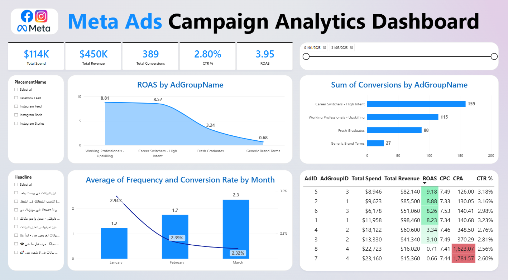

# Meta Ads Campaign Analytics Dashboard

### Turning campaign delivery data into a clear performance story

An interactive **Power BI** dashboard for exploring Meta Ads spend, revenue, conversions, and efficiency across ad groups, placements, and headlines.

*Dashboard preview · reporting period shown: January–March 2025*

## About the project

This report brings the key outcomes of a paid social campaign into one place. Use the slicers to explore results over time and compare delivery context, then use the detailed table to inspect ad-level efficiency metrics.

The Power BI report contains one page, **Dashboard**. The preview captures the date range **January 1–March 31, 2025**; results may change when filters are adjusted.

## Performance at a glance

| Metric | Value shown |
| --- | ---: |
| Total Spend | **$114K** |
| Total Revenue | **$450K** |
| Total Conversions | **389** |
| CTR | **2.80%** |
| ROAS | **3.95** |

Values above are transcribed from the supplied screenshot and reflect its selected date range and filter state. They are a visual snapshot, not a promise that every filter state will produce the same totals.

## What's inside

- **Return by ad group** — compare ROAS for Working Professionals – Upskilling, Career Switchers – High Intent, Fresh Graduates, and Generic Brand Terms.
- **Conversions by ad group** — see which audience groups contributed conversion volume.
- **Monthly efficiency trend** — follow average frequency and conversion rate by month.
- **Ad-level performance table** — review Ad ID, Ad Group ID, spend, revenue, ROAS, CPC, CPA, and CTR.
- **Interactive slicers** — filter by reporting date, placement, and headline.

Placement options shown in the report include Facebook Feed, Instagram Feed, Instagram Reels, and Instagram Stories. The report includes measures for Total Spend, Total Revenue, Total Conversions, CTR %, ROAS, CPC, and CPA.

## Explore it yourself

1. Download [`Meta_Ads Project.pbix`](<Meta_Ads%20Project.pbix>).
2. Open it in **Microsoft Power BI Desktop**.
3. Use the date, placement, and headline slicers to explore the report.

The preview image is static; the PBIX file contains the interactive report and its model.

## Files

- `Meta_Ads Project.pbix` — Power BI report and semantic model
- `dashboard-preview.png` — screenshot displayed on this page
- `README.md` — project overview and navigation guide
- `.gitignore` — excludes common temporary and lock files

## Data & refresh note

The PBIX includes its report model and underlying data. The available project files do not document a live Meta Ads API connection or an automatic refresh setup.

## License

No license is included. All rights are reserved by the project owner unless a license is added.
